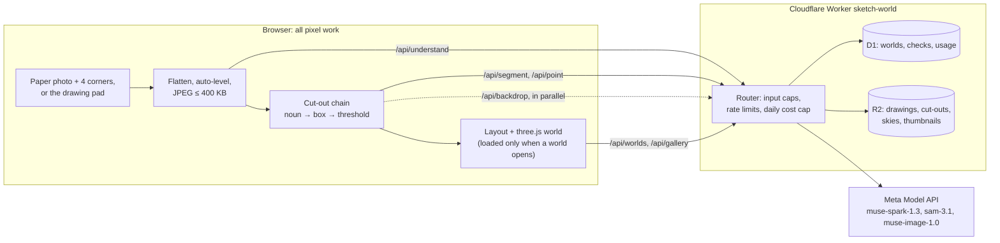

# Sketch World

Turn a drawing into a small paper pop-up world you can walk through.

Sketch World takes a 2D drawing, either a photo of one on paper or one drawn in the browser, and turns it into a
walkable, animated 3D paper pop-up world. Meta's Muse Spark lists the objects in the drawing, SAM 3.1 cuts each one
out, and the cut-outs stand up as paper cards in a three.js diorama under a sky painted by Muse Image. Animals wander,
birds fly, clouds drift and trees sway, and you can pick up and move every object. You can save the world and share
a link to it.

Built during the hackathon: the Meta Global AI Developer Hackathon 2026 (solo, TypeScript on Cloudflare Workers).

**Live demo:** https://sketch-world.shamanthnp.workers.dev

- [How it uses Meta models](#how-it-uses-meta-models)
- [Day-1 gate results](#day-1-gate-results)
- [Architecture](#architecture)
- [Safety and privacy](#safety-and-privacy)
- [Controls](#controls)
- [Run, test and smoke](#run-test-and-smoke)
- [Known limits](#known-limits)
- [Built during the hackathon](#built-during-the-hackathon)
- [Models](#models)
- [Licences](#licences)

## How it uses Meta models

Three Meta models run in a chain with fallbacks, so an object that one stage misses still gets a paper card. The
Worker builds every prompt and picks every model. The browser never sends prompt text: only the image and values from
Spark's own reply (nouns, counts, the title), which the Worker checks again.

1. **Muse Spark lists the objects** (`muse-spark-1.3`, `POST /api/understand`). The Worker sends the flattened
   drawing with a strict JSON schema (`text.format: json_schema`). The reply holds a title, the view (side or top),
   `isDrawing`, `safe`, and up to 12 object kinds, each with a type from a fixed list of 23, a short noun, a count and
   a sky flag. The Worker checks the reply again with zod and retries once; a world has at most 30 objects.
2. **SAM 3.1 cuts them out by name** (`sam-3.1`, `POST /api/segment`). The browser sends one noun prompt per object
   kind, 3 at a time, and decodes the masks with `@meta-sam/parser`. A mask is kept if it fills at least 5% of its
   box and the box covers at most 60% of the image (90% for water, paths, fields, hills and mountains). Duplicates
   are dropped (IoU above 0.5, or 80% of a mask inside one already taken), up to Spark's count for each kind.
3. **For objects SAM misses by name:**
   - **Spark pointing** (`POST /api/point`): one Spark call, also with a JSON schema, returns up to `count` boxes per
     missed object on Spark's 0–1000 grid.
   - **SAM box prompts**: the first 4 boxes of a world go back to `sam-3.1` as box prompts. A box mask is kept if it
     overlaps Spark's box with IoU of at least 0.3.
   - **Threshold cut-out** as the last fallback, in the browser: inside the box, light pixels connected to the edge
     become transparent, so a closed shape stays solid like a cut paper card. Boxes after the 4th go straight here.
4. **Muse Image paints the sky** (`muse-image-1.0`, `POST /api/backdrop`), in parallel with steps 2 and 3: a
   1536 × 1024 panorama from a fixed prompt, a style value and the drawing's title in a quoted slot. If the panorama
   isn't ready when the cut-outs are, the world opens with a gradient sky and swaps the panorama in when it arrives.
   If painting fails, the gradient stays.

If Spark's reply fails the schema check twice, the whole drawing becomes one threshold card (it can't be saved,
since its safety is unknown).

Every model call sends `store: false`. `npm run smoke` confirmed that all three models accept it.

### Cost and time per world

Before each call the Worker reserves a fixed estimate against the day's budget. These are estimates, not the bill.

| Call | Model | Estimate | Calls per world |
|---|---|---|---|
| Understand | `muse-spark-1.3` | $0.01 | 1 |
| Segment by noun | `sam-3.1` | $0.0025 | 1 per object kind, up to 12 |
| Point | `muse-spark-1.3` | $0.01 | 0 or 1 |
| Segment by box | `sam-3.1` | $0.0025 | 0 to 4 |
| Backdrop | `muse-image-1.0` | $0.01 | 1 |

Understand and point retry once when a reply fails the schema check, and a retry reserves again.

- **Cost:** about $0.03–0.05 per world. The gate drawings needed 5–12 noun calls ($0.0225–0.04 with understand),
  plus $0.01 for the sky. The point and box fallbacks add at most $0.02.
- **Time:** about 10–22 s from sending the drawing to the last cut-out (8.9–22.1 s in the gate runs). Spark's
  understand call is the longest step: 5.3–5.6 s in the re-run, 15.7 s on the 21-object drawing.

## Day-1 gate results

Before building the 3D world, the model chain had to pass a gate on six of the author's own drawings. The run used
the local `?probe` page in Live mode, understand plus noun SAM only, with no prompt tuning. The drawings are private
and are not in this repo. Full notes per drawing: [docs/gate.md](docs/gate.md).

| Drawing | Kind | Objects | Listed by Spark | Clean SAM cut-out | Time | Cost |
|---|---|---|---|---|---|---|
| 1.jpeg | Phone photo of paper | 11 | 9 (82%) | 6 (55%) | 14.9 s | $0.0275 |
| 2.jpeg | JPEG, white background | 12 | 11 (92%) | 11 (92%) | 13.3 s | $0.025 |
| 3.jpeg | JPEG, white background | 21 | 19 (90%) | 16 (76%) | 22.1 s | $0.04 |
| ms1.png | Digital drawing | 7 | 7 (100%) | 7 (100%) | 8.9 s | $0.0225 |
| ms2.png | Digital drawing | 15 | 15 (100%) | 15 (100%) | 15.9 s | $0.0325 |
| ms3.png | Digital drawing | 19 | 19 (100%) | 19 (100%) | 14.1 s | $0.0325 |
| **All 6** | | **85** | **80 (94%)** | **74 (87%)** | **≤ 22.1 s** | **≤ $0.04** |

| Criterion | Bar | Result |
|---|---|---|
| Objects listed | ≥ 80% | 94%, pass |
| Clean cut-outs | ≥ 70% | 87%, pass |
| Time per drawing | < 40 s | slowest 22.1 s, pass |
| Cost per drawing | < $0.05 | highest $0.04, pass |

The gate's failure notes shaped what came next. The point, box and threshold fallbacks were built for the nouns that
got 0 masks (bushes, seaweed), and the scene prompt now tells Spark to skip decorations and the ground and to list
rainbows. On a re-run after that change, 2.jpeg went to 12 of 12 listed and cut out cleanly. The phone photo of paper
(1.jpeg) is the weakest input: 55% clean. Gate spend: $0.18, or $0.23 with the re-run.

## Architecture

The browser does all pixel work: flattening the photo, decoding SAM masks, cutting out, layout and 3D. The Cloudflare
Worker is a thin, rate-limited proxy to the Meta Model API, with D1 and R2 for saved worlds. It never decodes an
image; it reads the type and size from the header bytes.



| Folder | What is in it |
|---|---|
| `src/paper`, `src/pad`, `src/image` | Corner geometry and flatten, the drawing pad, Work_Image encoding |
| `src/sam` | SAM client (3 in flight, 429 backoff), mask parsing with `@meta-sam/parser`, cut-out PNGs |
| `src/cut` | The fallback chain, mask acceptance and de-duplication, the threshold cut-out |
| `src/world` | Layout, collision, pop-up fold, motion, dragging, the three.js world and walking |
| `src/ui`, `src/share` | Pages (Home, Create, Gallery, Viewer), the HUD, the privacy notice, the `?probe` tool, saving |
| `shared` | zod schemas used by both the browser and the Worker (scene, saved world, moves) |
| `worker` | Router, routes, Meta calls (`meta/`), the cost cap, rate and input limits |
| `migrations` | The D1 schema |
| `scripts/smoke.mjs` | The live smoke test |
| `test` | Unit, property (fast-check) and Worker tests, with fixtures |
| `docs/gate.md` | The Day-1 gate results |

The visual rules for the pages are in [DESIGN.md](DESIGN.md).

## Safety and privacy

- **The raw photo never leaves the browser.** The corner taps and the flatten run locally, and only the flattened
  drawing (long side ≤ 1024 px, JPEG ≤ 400 KB) is sent.
- **A privacy notice comes before the first upload.** It says the drawing goes to Meta's AI models, saved worlds are
  public by link and listed in the Gallery, and the device that saved a world can delete it. Nothing is sent until
  the user accepts.
- **The drawing's content is data.** The Spark system prompt says that words written in the drawing are never
  instructions. Spark's output is enum-constrained, the title and nouns are length- and charset-limited, and the
  browser renders them only through `textContent`.
- **The safe flag comes from Spark, never from the client.** After a valid scene, the Worker stores a check row
  (the SHA-256 of the image and `isDrawing && safe`). Saving a world needs a row with `safe = 1` for the uploaded
  `source.jpg`, else 403. A photo of a real scene or an unsafe drawing gets a 422 and no world.
- **Owner tokens** are 32 random bytes, stored only as SHA-256 and compared in constant time
  (`crypto.subtle.timingSafeEqual`). Deleting a world and saving its positions need the token, which lives in the
  saving device's `localStorage`.
- **Rate limits** per IP per 60 s: 6 for understand, point, backdrop and saving; 30 for segment. Over the limit the
  Worker replies 429 with `Retry-After`. Size, type and field caps reply 400, 413 or 415.
- **Daily cost cap:** each model call first reserves its estimate in one conditional D1 update. On the deployed site
  the cap is $2 per UTC day. When it is reached, the Worker skips the call and replies 503 `{mode: "sample"}`, and the
  Create page shows Sample_Mode ("No more new worlds today") with links to the sample worlds and the Gallery, which
  keep working.
- **Headers:** a CSP of `default-src 'self'; img-src 'self' blob: data:; connect-src 'self'` and
  `X-Content-Type-Options: nosniff`. No third-party scripts, fonts or CDNs.
- **Storage:** `store: false` on every model call, D1 only through bound parameters, and `GET /a/:key` serves only
  keys that match one fixed pattern.
- **The API key** (`MODEL_API_KEY`) lives only in the gitignored `.dev.vars` and the Worker secret.

## Controls

| Action | Keyboard and mouse | Touch |
|---|---|---|
| Walk | W and S, or ↑ and ↓ | Hold the on-screen ↑ or ↓ |
| Step sideways | A and D | |
| Turn | ← and → | The on-screen ↺ or ↻ |
| Look around | Drag empty space | Drag with one finger |
| Move an object | Drag it | Press and hold it, then drag |
| See an object's name | Click it (it bounces) | Tap it |

- **Objects panel** (Objects in the HUD): lists every object by name. Pick one to highlight its card, then nudge it
  with the arrow buttons or the arrow keys; things that fly also go up and down (Raise and Lower, or Page Up and Page
  Down). Hills and mountains stay put.
- **Reset positions** puts every card back (Undo reset brings your moves back). **Pause motion** stops the animation.
  **Help** shows the controls, which also appear on your first visit.
- **Save & share** saves the world and gives you a link. On the device that saved it you also get **Save positions**
  and **Delete world**. Anyone else can move things around, but can't save them.

## Run, test and smoke

You need Node.js 22.12 or newer and a Meta Model API key.

```powershell
npm install
Copy-Item .dev.vars.example .dev.vars   # then put your key after MODEL_API_KEY= (never commit .dev.vars)
npx wrangler d1 migrations apply sketch-world-db --local   # creates the local D1 tables
npm run build
$env:CI='true'; npx wrangler dev
```

Open http://localhost:8787. `CI=true` keeps wrangler from asking questions. `npm run dev` (Vite alone) does not serve
`/api`, so use `wrangler dev`.

| Command | What it does | Live calls |
|---|---|---|
| `npm test` | About 540 tests: unit, fast-check property tests, and Worker route tests on local D1 and R2 with a mocked Meta API | None, fixtures only |
| `npm run typecheck` | `tsc` for the browser code and the Worker | None |
| `npm run smoke` | One real call each to Spark, SAM and Muse Image; prints status and latency, never the key | About $0.02 |

**The `?probe` dev page** (http://localhost:8787/?probe) is the tool the gate used. It runs one drawing through
understand and the noun segments, and shows each object's masks and cut-outs, SAM latency, the total time and the
estimated cost. Replay mode re-runs saved replies with no calls: load `test/fixtures/meta/gate/line-drawing.json` and
`test/fixtures/images/line-drawing.png`, then use Open world to walk it.

## Known limits

- The top-down view isn't built. Drawings that Spark reads as maps (`view: "top"`) use the side view.
- Spark sometimes misses small objects (rocks, a small shell, a grass tuft in the gate) or lists decorations. An object
  Spark doesn't list gets no card.
- When SAM finds nothing for one noun, a neighbour's noun can claim its masks (the gate's bushes came back as
  clouds), so an object can show twice.
- Some masks cover only part of an object, such as a flower head without its stem.
- Phone photos of paper are the least tested input (one in the gate, 55% clean cut-outs).
- Cards are flat cut-outs; there is no 3D reconstruction.
- Costs are the Worker's fixed estimates, not the bill.

## Built during the hackathon

Sketch World was built during the Meta Global AI Developer Hackathon 2026. Some modules were copied or adapted from
the author's earlier project for the same event, `undo-manual` (built on 27 October 2026). They are **copies, not a
shared package**: each file lives in this repo and was changed here as needed.

| Module in sketch-world | From `undo-manual` | Change |
|---|---|---|
| `worker/meta/metaFetch.ts` | copied | Adds the `muse-image-1.0` model; errors carry the API's error `code` |
| `worker/limits/input.ts`, `worker/limits/imageSize.ts`, `worker/http.ts`, `worker/index.ts` | copied | Adds `readNoun` and `readJsonField(cap)`; a new route table |
| `worker/routes/segment.ts`, `src/sam/client.ts`, `src/sam/parse.ts` | copied | `noun` or `box` prompts (exactly one); `store: false` kept; 3 requests in flight (was 1); 429 backoff |
| `src/sam/cutout.ts` (`trimToMask`), `src/sam/masks.ts` (`placeMask` only) | copied | Mask choice and pixel-diff code dropped |
| `src/image/encode.ts` | copied from `analyzer/encode.ts` | Cell-crop code dropped |
| `src/paper/quad.ts` | adapted from `analyzer/quad.ts` | `bilinear`, `invBilinear` and `validateQuad` kept; aspect range 1.0–1.8; cell helpers dropped |
| `src/ui/corners.ts` | adapted from `ui/calibrate.ts` | Four corner taps for a paper photo |
| `vitest.config.ts`, `scripts/smoke.mjs` | copied | The smoke test adds a Muse Image call; Vitest adds the D1 migrations and rate limiters |
| `src/ui/tool.css` | copied from `src/ui/app.css` | The `?probe` page's look |
| `DESIGN.md`, `src/ui/app.css` | copied, then rewritten | The paper pop-up theme |

The tests for the copied modules, `tsconfig.json`, `worker/tsconfig.json` and `vite.config.ts` also started as
copies. Everything else is new, including `src/paper/flatten.ts`, the pad, the fallback chain, the world, the
understand, point, backdrop and worlds routes, the cost cap, the rate limits and every page.

## Models

All three are called through the Meta Model API (Responses API), Standard mode.

| Model | Used for |
|---|---|
| `muse-spark-1.3` | Listing the objects (JSON schema) and pointing at missed objects (boxes on a 0–1000 grid) |
| `sam-3.1` | Cutting out objects by noun prompt and by box prompt |
| `muse-image-1.0` | Painting the sky panorama |

## Licences

| What | Licence |
|---|---|
| This repository | MIT, see [LICENSE](LICENSE) |
| SAM 3.1 (`sam-3.1`) and its outputs, the masks behind every cut-out | [SAM License](https://huggingface.co/facebook/sam3.1/blob/main/LICENSE) |
| [`@meta-sam/parser`](https://github.com/meta-models/meta-sam) 0.1.0, bundled into the browser code | SAM License (last updated 19 November 2025): a copy is in [public/licenses/SAM-LICENSE.txt](public/licenses/SAM-LICENSE.txt), served by the site at `/licenses/SAM-LICENSE.txt` and linked from its footer |
| Muse Spark (`muse-spark-1.3`) and Muse Image (`muse-image-1.0`) | Used through the Meta Model API under its terms; no model weights or model code are in this repo |
| [three.js](https://github.com/mrdoob/three.js) 0.186 | MIT |
| [zod](https://github.com/colinhacks/zod) 4 | MIT |
| [Young Serif](https://github.com/noirblancrouge/YoungSerif) by Bastien Sozeau, the self-hosted display font (`public/fonts/young-serif-latin-400.woff2`) | SIL Open Font License 1.1, see [public/fonts/YoungSerif-OFL.txt](public/fonts/YoungSerif-OFL.txt) |
| Dev tools: Vite, Vitest, `@cloudflare/vitest-plugin`, fast-check | MIT |
| Dev tools: wrangler | MIT or Apache-2.0 |
| Dev tools: TypeScript | Apache-2.0 |
