# Sketch World

Turn a drawing into a small paper pop-up world you can walk through.

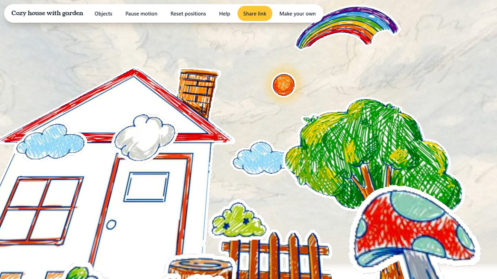

Sketch World takes a 2D drawing, either a photo of one on paper or one drawn in the browser, and turns it into a
walkable, animated 3D paper pop-up world. Meta's Muse Spark lists the objects in the drawing, SAM 3.1 cuts each one
out, and the cut-outs stand up as paper cards in a three.js diorama under a sky painted by Muse Image. Animals wander,
birds fly, clouds drift and trees sway, and you can pick up and move every object. You can save the world and share
a link to it.

Built during the hackathon: the Meta Global AI Developer Hackathon 2026 (solo, TypeScript on Cloudflare Workers).

**Live demo:** https://sketch-world.shamanthnp.workers.dev. It may be taken offline after the event. Everything below
runs on your own computer with your own Meta Model API key, and needs no Cloudflare account.

- [What it looks like](#what-it-looks-like)
- [Quick start](#quick-start)
- [Run it locally](#run-it-locally): [prerequisites](#prerequisites), [step by step](#step-by-step),
  [try it](#try-it), [cost and limits](#cost-and-limits-when-running-locally), [tests](#tests-without-a-key),
  [live smoke](#live-smoke), [the `?probe` page](#the-probe-dev-page), [troubleshooting](#troubleshooting)
- [Deploy your own copy (optional)](#deploy-your-own-copy-optional)
- [How it uses Meta models](#how-it-uses-meta-models)
- [Day-1 gate results](#day-1-gate-results)
- [Architecture](#architecture)
- [Safety and privacy](#safety-and-privacy)
- [Controls](#controls)
- [Approving worlds for the Gallery](#approving-worlds-for-the-gallery)
- [Known limits](#known-limits)
- [Built during the hackathon](#built-during-the-hackathon)
- [Models](#models)
- [Licences](#licences)

## What it looks like

The three sample worlds are live: [Cozy house with garden](https://sketch-world.shamanthnp.workers.dev/w/TyvjYUpV22),
[House with tree and rainbow](https://sketch-world.shamanthnp.workers.dev/w/1KFuQknI34) and
[House with Two Trees](https://sketch-world.shamanthnp.workers.dev/w/Tco7s8pREl).

<table>
  <tr>
    <td width="50%">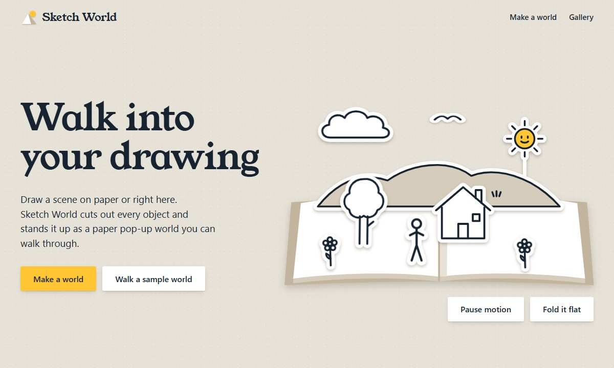<br>Home: make a world, or walk a sample one.</td>
    <td width="50%">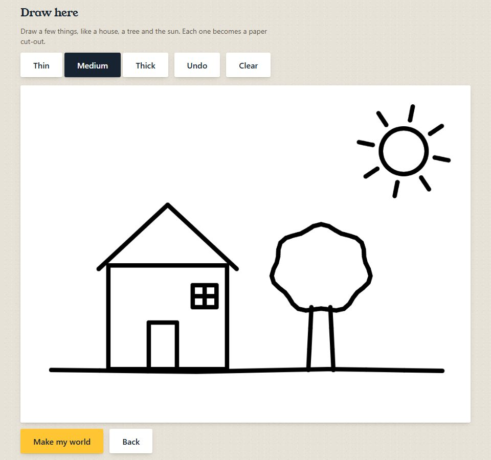<br>Draw here: a house, a tree and the sun on the pad.</td>
  </tr>
  <tr>
    <td width="50%">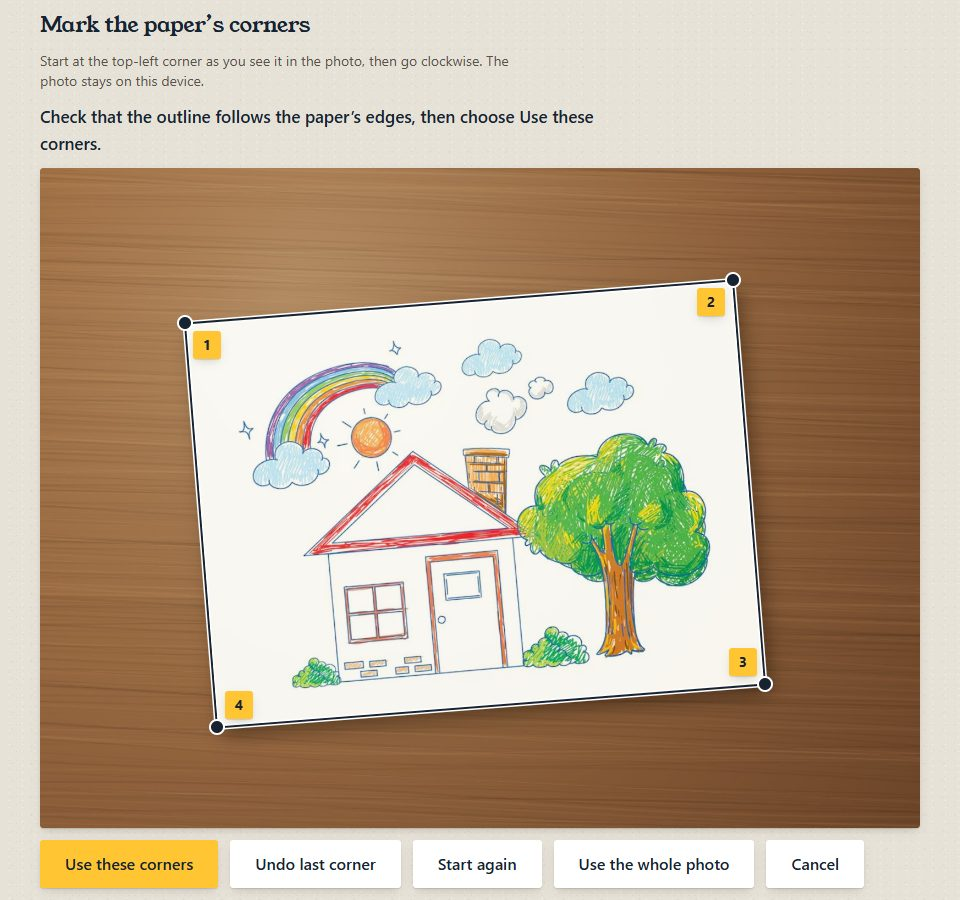<br>Or a photo of paper: tap its 4 corners and it is flattened on the device.</td>
    <td width="50%">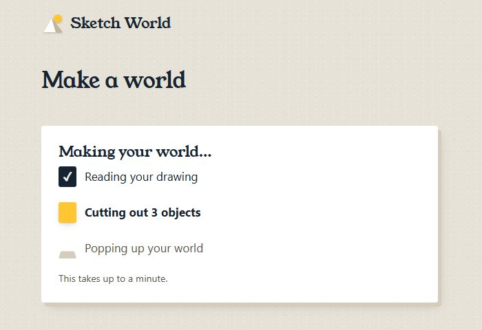<br>Making your world: Spark has listed 3 objects and SAM cuts them out.</td>
  </tr>
  <tr>
    <td width="50%">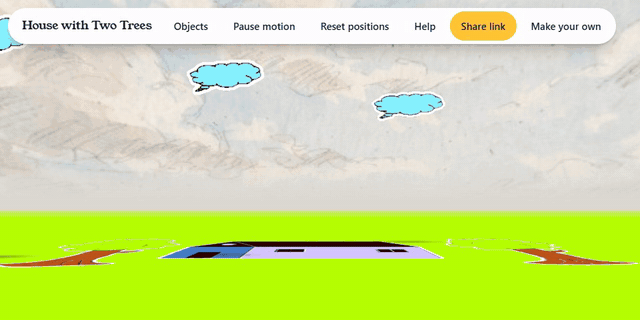<br>The cards pop up out of the ground when the world opens.</td>
    <td width="50%">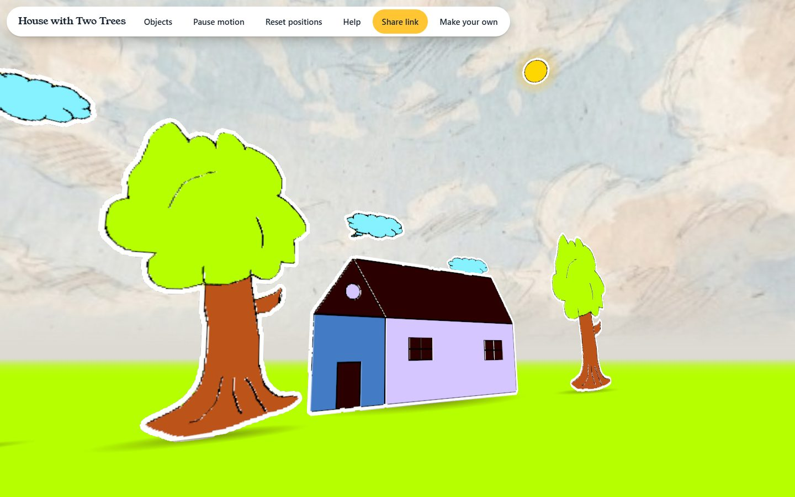<br>House with Two Trees, under a sky painted by Muse Image.</td>
  </tr>
  <tr>
    <td width="50%">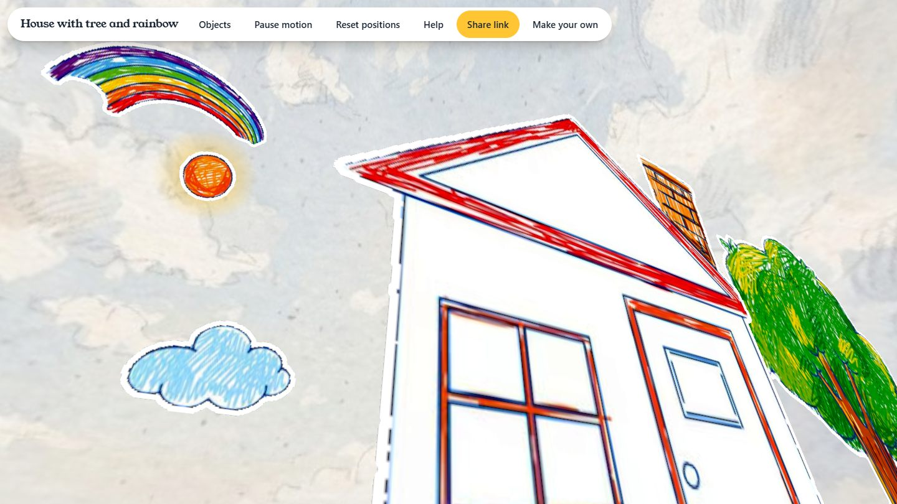<br>House with tree and rainbow, from examples/drawings/2.jpeg.</td>
    <td width="50%">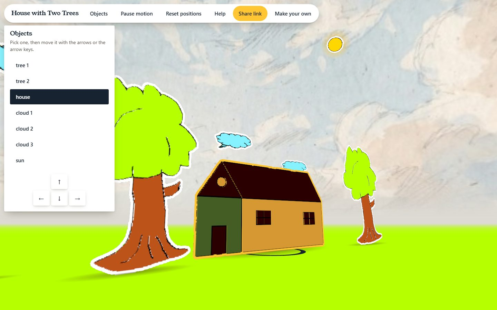<br>Objects panel: pick the house, then move it with the arrows.</td>
  </tr>
  <tr>
    <td width="50%">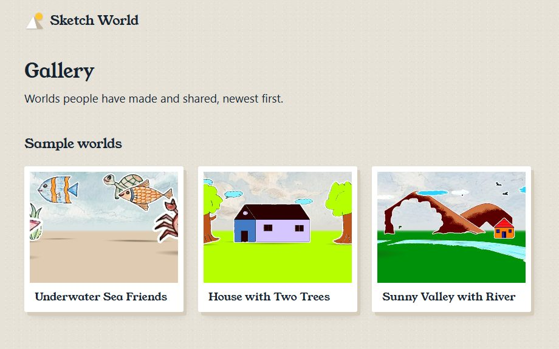<br>The Gallery with the three sample worlds.</td>
    <td width="50%">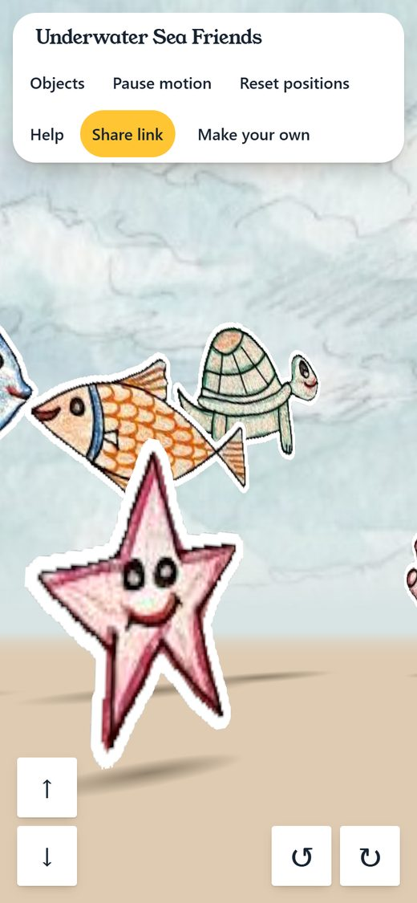<br>On a phone: hold ↑ or ↓ to walk, tap ↺ or ↻ to turn.</td>
  </tr>
</table>

## Quick start

You need Node.js 22.12 or newer, Git, a Meta Model API key and a browser with WebGL. Each world you make costs about
$0.03–0.06, billed to the key. If a step fails, see [Step by step](#step-by-step) and
[Troubleshooting](#troubleshooting).

Windows (PowerShell):

```powershell
git clone https://github.com/Shamanthnp1/sketch-world.git; cd sketch-world
npm install
Copy-Item .dev.vars.example .dev.vars    # then open .dev.vars and put your key after MODEL_API_KEY=
$env:CI='true'; npx wrangler d1 migrations apply sketch-world-db --local
npm run build
$env:CI='true'; npx wrangler dev
```

macOS or Linux (bash, zsh):

```bash
git clone https://github.com/Shamanthnp1/sketch-world.git && cd sketch-world
npm install
cp .dev.vars.example .dev.vars    # then open .dev.vars and put your key after MODEL_API_KEY=
CI=true npx wrangler d1 migrations apply sketch-world-db --local
npm run build
CI=true npx wrangler dev
```

Open http://localhost:8787, choose **Make a world**, then **Choose a photo** under "Photo of a drawing", pick
`examples/drawings/2.jpeg` and choose **Use the whole photo**.

## Run it locally

### Prerequisites

- **Node.js 22.12 or newer**, with npm (it comes with Node). Node 22 LTS or 24 LTS is safest: Vite 8 needs 20.19+
  or 22.12+, wrangler 4 needs 22+, and Vitest 5 supports 22.12+, 24 and 26+ but not 23 or 25. Check with `node -v`.
- **Git.**
- **A Meta Model API key.** During the hackathon, use the key from the hackathon's developer portal. Otherwise create
  one in the Model API dashboard under API keys, as Meta's help page
  [How do I create an API key?](https://dev.meta.ai/help/api-keys/create-api-key) describes. Every model call is
  billed to the key's account.
- **No Cloudflare account.** `wrangler dev` runs the Worker, D1 (SQLite), R2 and the rate limiters on your computer,
  and the local commands below never ask for a login. This was checked on a fresh clone with an empty wrangler
  config folder, so no saved login could be used.
- **A browser with WebGL**, such as a current Chrome, Edge, Firefox or Safari with hardware acceleration on.
- **The local Workers runtime** (workerd, installed by `npm install`) needs glibc 2.35 or newer on Linux (Ubuntu 22.04
  or Debian 12 and later) and macOS 13.5 or newer with the Xcode command line tools (`xcode-select --install`) on a
  Mac, per the [workerd README](https://github.com/cloudflare/workerd). These steps were tested on Windows 11 with
  Node 24 and PowerShell 5.1.

### Step by step

Run these in a terminal. Where Windows PowerShell and bash differ, both are shown; Git Bash on Windows takes the bash
lines.

1. **Clone the repo** and go into it. This downloads the code and the example drawings.

   ```
   git clone https://github.com/Shamanthnp1/sketch-world.git
   cd sketch-world
   ```

2. **Install the dependencies.** This puts Vite, wrangler with the local Workers runtime, three.js and the test tools
   in `node_modules/`.

   ```
   npm install
   ```

3. **Add your key.** This makes `.dev.vars`, the file wrangler reads the Worker's secret from.

   ```powershell
   Copy-Item .dev.vars.example .dev.vars    # PowerShell
   ```

   ```bash
   cp .dev.vars.example .dev.vars           # bash
   ```

   Open `.dev.vars` in a text editor (for example `notepad .dev.vars`, `open -e .dev.vars` or `nano .dev.vars`) and
   put your key right after the `=`, on one line, with no spaces or quotes: `MODEL_API_KEY=<your key>`. The file
   must hold only that line. It is gitignored; never commit it or paste it anywhere.

4. **Create the local database tables.** This applies `migrations/0001_init.sql`, `0002_listed.sql` and
   `0003_usage_ip.sql` to a local SQLite file under `.wrangler/state/`. Nothing touches the cloud. `CI=true` keeps
   wrangler from asking questions.

   ```powershell
   $env:CI='true'; npx wrangler d1 migrations apply sketch-world-db --local    # PowerShell
   ```

   ```bash
   CI=true npx wrangler d1 migrations apply sketch-world-db --local           # bash
   ```

5. **Build the site.** Vite writes the browser app to `dist/`, which `wrangler dev` serves. Its warning that some
   chunks are larger than 500 kB is expected: that is three.js, loaded only when a world opens.

   ```
   npm run build
   ```

6. **Start the Worker.** This serves the site and `/api` on http://localhost:8787 with local D1, R2 and rate
   limiters. It is ready when it prints `Ready on http://127.0.0.1:8787`. Leave it running: it logs one line per
   model call (route, model, status and latency, never the key). Stop it with Ctrl+C.

   ```powershell
   $env:CI='true'; npx wrangler dev    # PowerShell
   ```

   ```bash
   CI=true npx wrangler dev            # bash
   ```

7. **Open http://localhost:8787** in your browser.

`npm run dev` (Vite alone) doesn't serve `/api`, so always use `wrangler dev`.

### Try it

1. Choose **Make a world**.
2. Under **Photo of a drawing**, choose **Choose a photo** and pick a file from `examples/drawings/`:

   | File | What is in it | Size |
   |---|---|---|
   | `2.jpeg` | A house, a tree, the sun, a rainbow, clouds and two bushes, in crayon on white | 740 × 545, 136 KB |
   | `3.jpeg` | 21 things: a house, two trees, a fence, a campfire, a log, mushrooms, a rainbow, clouds and more | 740 × 725, 212 KB |
   | `ms1.png` | A digital drawing of a house, two apple trees, three clouds and the sun | 3346 × 1186, 145 KB |

3. Choose **Use the whole photo**: each example is the drawing itself, with no paper edges to mark. For a phone photo
   of paper, tap the paper's 4 corners instead. Use the whole photo takes any shape up to 4 : 1, so `ms1.png`
   (2.82 : 1) works as it is.

   
4. The first time, a privacy notice says where the drawing goes. Choose **Send my drawing**.

Or choose **Start drawing** under **Draw here**, draw a house, a tree and the sun, and choose **Make my world**.

What to expect:

- "Making your world…" shows three steps. The world opens about 10–25 s after you send the drawing. Spark's listing
  takes about 5–15 s of that, then SAM cuts the objects out.
- The paper cards pop up out of the ground. The painted sky can arrive a few seconds later; until then the sky is a
  gradient.
- Walk with W, A, S and D or the arrow keys, drag empty space to look around, and drag a card to move it. All the
  controls are in [Controls](#controls), and Help shows them on your first visit. If a big card fills the view when
  the world opens (the house in `2.jpeg` stands close to the start), walk back with S or turn with ← and →.
- **Save & share** saves the world and shows a link such as `http://localhost:8787/w/AbCd123456`. Open it in another
  tab or a private window: the same world opens, with the moves you saved. The browser that saved it also gets
  Save positions and Delete world.
- Saved worlds stay on your computer, in the local D1 and R2 under `.wrangler/state/`. Deleting `.wrangler/` deletes
  them and the local tables, so run step 4 again afterwards.
- The local Gallery starts empty: the sample worlds are in the deployed site's database, and a new world is not
  listed until it is approved. To list one of your local worlds, run
  `npx wrangler d1 execute sketch-world-db --local --command "UPDATE worlds SET listed = 1 WHERE id = '<id>'"`, with
  the 10 letters and digits after `/w/` as `<id>` (add `$env:CI='true';` or `CI=true` in front as in step 4).

### Cost and limits when running locally

- **Cost:** a world makes 1 Spark call to list the objects, 1 SAM call per kind of object (up to 12), sometimes 1
  Spark pointing call and up to 4 SAM box calls, and 1 Muse Image call for the sky. At the Worker's fixed estimates
  in `worker/cost.ts` (Spark $0.01, SAM $0.0025, Muse Image $0.01 a call; see
  [Cost and time per world](#cost-and-time-per-world)) that is about $0.03–0.06 a world, billed to your key. These
  are estimates; Meta's bill is the real figure.
- **Daily cap:** `DAILY_COST_CAP_USD` in `wrangler.jsonc`, $5 per UTC day, counted in the local D1.
- **Per-visitor budget:** `PER_IP_DAILY_USD` in `wrangler.jsonc`, $0.50 per client per UTC day, about 10–14 worlds.
  Locally every request comes from your own computer (wrangler gives the Worker `127.0.0.1` as the client address),
  so the whole local run counts as one client. After about 10–14 worlds in one UTC day, Create says "No more new
  worlds today" and "You've made a lot of worlds today".
- **To raise it for a long judging session**, without editing any tracked file, start `wrangler dev` with `--var`.
  It overrides the value in `wrangler.jsonc` for that run only. The binding list at startup shows the value as
  `"(hidden)"`; that is normal. $2 is about 40–57 worlds. `--var DAILY_COST_CAP_USD:10` raises the daily cap the same
  way.

  ```powershell
  $env:CI='true'; npx wrangler dev --var PER_IP_DAILY_USD:2    # PowerShell
  ```

  ```bash
  CI=true npx wrangler dev --var PER_IP_DAILY_USD:2           # bash
  ```

  Don't put these values in `.dev.vars`: the deploy command uploads every line of that file as a secret.
- **Rate limits** per client per minute: 6 requests each to understand, point, backdrop and saving, and 30 to
  segment. Over a limit the Worker replies 429; wait a minute and try again.

### Tests without a key

| Command | What it does |
|---|---|
| `npm test` | About 620 tests in about 30 s: unit, fast-check property and Worker route tests on local D1 and R2 with a mocked Meta API. No key, no `.dev.vars` and no network calls. Without `.dev.vars` it warns "Missing required secrets: MODEL_API_KEY"; the tests use a fake key, so that is expected |
| `npm run typecheck` | `tsc` for the browser code and the Worker |

### Live smoke

`npm run smoke` makes one real call each to Spark, SAM and Muse Image with the key in `.dev.vars`, about $0.02. It
prints each call's model, status and latency, never the key. It saves the replies over
`test/fixtures/meta/smoke-*.json`, so git shows those files as changed afterwards.

### The `?probe` dev page

http://localhost:8787/?probe is the tool the gate used. Live mode runs one drawing through understand and the noun
segments only (no sky) and shows each object's masks, cut-outs, SAM latency, the total time and the estimated cost.
Replay mode re-runs saved replies with no calls: load `test/fixtures/meta/gate/line-drawing.json` and
`test/fixtures/images/line-drawing.png`, then use Open world to walk it.

### Troubleshooting

| What you see | What to do |
|---|---|
| `wrangler dev` says the address or port 8787 is in use | Use another port, `npx wrangler dev --port 8790`, and open http://localhost:8790 |
| The Gallery says "The gallery couldn’t load", making a world fails, `http://localhost:8787/api/gallery` replies 500 `{"error":"Internal error"}`, and the log shows `[ERROR] {"route":"GET /api/gallery","error":"Error"}` | The local tables are missing: run step 4, then restart `wrangler dev` |
| The world opens as one big card, "Your drawing", with "Sketch World couldn’t tell the things in your drawing apart", and the `wrangler dev` log shows `"status":401` or `"status":403` for `muse-spark-1.3` | The key is missing or wrong. Check that `.dev.vars` holds one line, `MODEL_API_KEY=` followed by the key, then stop and restart `wrangler dev` |
| "No more new worlds today" | The local per-visitor budget ("You've made a lot of worlds today") or the daily cap is used up. Restart with `--var PER_IP_DAILY_USD:2` as in [Cost and limits](#cost-and-limits-when-running-locally), or wait for 00:00 UTC |
| "Lots of worlds are being made right now" | A rate limit; wait a minute |
| wrangler asks a question, waits for input or wants to log in | Set `CI=true` as in steps 4 and 6. The local commands never need a login; only commands with `--remote` and `wrangler deploy` do |
| The world stays blank, or "This world couldn’t open" | WebGL is off. Turn on hardware acceleration in the browser's settings, or try another browser |
| Code changes don't show | Run `npm run build` again and restart `wrangler dev`; it serves the `dist/` you built |
| On Linux, `GLIBC_2.35 not found` | The local Workers runtime needs a newer glibc (Ubuntu 22.04 or Debian 12 and later) |
| npm prints `EBADENGINE`, or `npm test` fails to start | Node is too old; install Node 22.12 or newer |

## Deploy your own copy (optional)

Only for someone with a Cloudflare account who wants their own public copy; judging doesn't need it. Every world made
on it is billed to the key you upload.

1. `npx wrangler login`.
2. Create a D1 database and an R2 bucket with your own names: `npx wrangler d1 create <your-db>` and
   `npx wrangler r2 bucket create <your-bucket>`.
3. In `wrangler.jsonc`, put your database's name and the `database_id` that `d1 create` printed, and your bucket's
   name. Set `SAMPLE_WORLD_IDS` to `""` (the ids in it are worlds on the author's site). The rate-limit
   `namespace_id`s (74031–74035) must be unique in your account; change them if they clash with ones you use.
4. `npx wrangler d1 migrations apply <your-db> --remote`.
5. `npm run build`.
6. `npx wrangler deploy --secrets-file .dev.vars`. This uploads every line of `.dev.vars` as a secret, so it must
   hold only `MODEL_API_KEY`.

The site is then at `https://sketch-world.<your-subdomain>.workers.dev`.

## How it uses Meta models

Three Meta models run in a chain with fallbacks, so an object that one stage misses still gets a paper card. The
Worker builds every prompt and picks every model. The browser never sends prompt text: only the image and values from
Spark's own reply (nouns, counts, the title), which the Worker checks again.

1. **Muse Spark lists the objects** (`muse-spark-1.3`, `POST /api/understand`). The Worker sends the flattened
   drawing with a strict JSON schema (`text.format: json_schema`). The reply holds a title, the view (side or top),
   `isDrawing`, `safe`, and up to 12 object kinds, each with a type from a fixed list of 23, a short noun, a count and
   a sky flag. The Worker checks the reply again with zod and retries once; a world has at most 30 objects.
2. **SAM 3.1 cuts them out by name** (`sam-3.1`, `POST /api/segment`). The browser sends one noun prompt per object
   kind, 3 at a time, and decodes the masks with `@meta-sam/parser`. A mask is kept if it fills at least 5% of its
   box and the box covers at most 60% of the image (90% for water, paths, fields, hills and mountains). Duplicates
   are dropped (IoU above 0.5, or 80% of a mask inside one already taken), up to Spark's count for each kind.
3. **For objects SAM misses by name:**
   - **Spark pointing** (`POST /api/point`): one Spark call, also with a JSON schema, returns up to `count` boxes per
     missed object on Spark's 0–1000 grid.
   - **SAM box prompts**: the first 4 boxes of a world go back to `sam-3.1` as box prompts. A box mask is kept if it
     overlaps Spark's box with IoU of at least 0.3.
   - **Threshold cut-out** as the last fallback, in the browser: inside the box, light pixels connected to the edge
     become transparent, so a closed shape stays solid like a cut paper card. Boxes after the 4th go straight here.
4. **Muse Image paints the sky** (`muse-image-1.0`, `POST /api/backdrop`), in parallel with steps 2 and 3: a
   1536 × 1024 panorama from a fixed prompt, a style value and the drawing's title in a quoted slot. If the panorama
   isn't ready when the cut-outs are, the world opens with a gradient sky and swaps the panorama in when it arrives.
   If painting fails, the gradient stays.

If Spark's reply fails the schema check twice, the whole drawing becomes one threshold card (it can't be saved,
since its safety is unknown).

Every model call sends `store: false`. `npm run smoke` confirmed that all three models accept it.

### Cost and time per world

Before each call the Worker reserves a fixed estimate against the day's budget. These are estimates, not the bill.

| Call | Model | Estimate | Calls per world |
|---|---|---|---|
| Understand | `muse-spark-1.3` | $0.01 | 1 |
| Segment by noun | `sam-3.1` | $0.0025 | 1 per object kind, up to 12 |
| Point | `muse-spark-1.3` | $0.01 | 0 or 1 |
| Segment by box | `sam-3.1` | $0.0025 | 0 to 4 |
| Backdrop | `muse-image-1.0` | $0.01 | 1 |

Understand and point retry once when a reply fails the schema check, and a retry reserves again.

- **Cost:** about $0.03–0.06 per world; the sample worlds cost $0.03–0.06. The gate drawings needed 5–12 noun calls
  ($0.0225–0.04 with understand), plus $0.01 for the sky. The point and box fallbacks add at most $0.02.
- **Time:** about 10–25 s from sending the drawing to the last cut-out (8.9–22.1 s in the gate runs). Spark's
  understand call is the longest step: 5.3–5.6 s in the re-run, 15.7 s on the 21-object drawing.

## Day-1 gate results

Before building the 3D world, the model chain had to pass a gate on six of the author's own drawings. The run used
the local `?probe` page in Live mode, understand plus noun SAM only, with no prompt tuning. Three of the drawings,
`2.jpeg`, `3.jpeg` and `ms1.png`, are in [examples/drawings/](examples/drawings/); the other three are private and not
in this repo. Full notes per drawing: [docs/gate.md](docs/gate.md).

| Drawing | Kind | Objects | Listed by Spark | Clean SAM cut-out | Time | Cost |
|---|---|---|---|---|---|---|
| 1.jpeg | Phone photo of paper | 11 | 9 (82%) | 6 (55%) | 14.9 s | $0.0275 |
| 2.jpeg | JPEG, white background | 12 | 11 (92%) | 11 (92%) | 13.3 s | $0.025 |
| 3.jpeg | JPEG, white background | 21 | 19 (90%) | 16 (76%) | 22.1 s | $0.04 |
| ms1.png | Digital drawing | 7 | 7 (100%) | 7 (100%) | 8.9 s | $0.0225 |
| ms2.png | Digital drawing | 15 | 15 (100%) | 15 (100%) | 15.9 s | $0.0325 |
| ms3.png | Digital drawing | 19 | 19 (100%) | 19 (100%) | 14.1 s | $0.0325 |
| **All 6** | | **85** | **80 (94%)** | **74 (87%)** | **≤ 22.1 s** | **≤ $0.04** |

| Criterion | Bar | Result |
|---|---|---|
| Objects listed | ≥ 80% | 94%, pass |
| Clean cut-outs | ≥ 70% | 87%, pass |
| Time per drawing | < 40 s | slowest 22.1 s, pass |
| Cost per drawing | < $0.05 | highest $0.04, pass |

The gate's failure notes shaped what came next. The point, box and threshold fallbacks were built for the nouns that
got 0 masks (bushes, seaweed), and the scene prompt now tells Spark to skip decorations and the ground and to list
rainbows. On a re-run after that change, 2.jpeg went to 12 of 12 listed and cut out cleanly. The phone photo of paper
(1.jpeg) is the weakest input: 55% clean. Gate spend: $0.18, or $0.23 with the re-run.

## Architecture

The browser does all pixel work: flattening the photo, decoding SAM masks, cutting out, layout and 3D. The Cloudflare
Worker is a thin, rate-limited proxy to the Meta Model API, with D1 and R2 for saved worlds. It never decodes an
image; it reads the type and size from the header bytes.

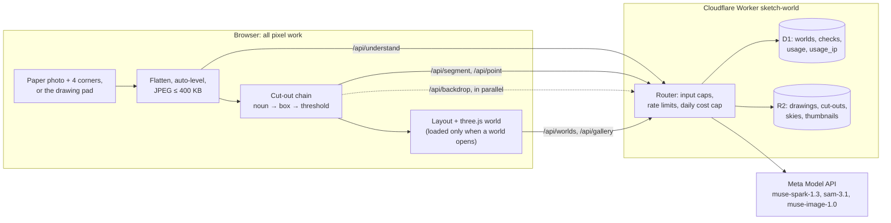

| Folder | What is in it |
|---|---|
| `src/paper`, `src/pad`, `src/image` | Corner geometry and flatten, the drawing pad, Work_Image encoding |
| `src/sam` | SAM client (3 in flight, 429 backoff), mask parsing with `@meta-sam/parser`, cut-out PNGs |
| `src/cut` | The fallback chain, mask acceptance and de-duplication, the threshold cut-out |
| `src/world` | Layout, collision, pop-up fold, motion, dragging, the three.js world and walking |
| `src/ui`, `src/share` | Pages (Home, Create, Gallery, Viewer), the HUD, the privacy notice, the `?probe` tool, saving |
| `shared` | zod schemas used by both the browser and the Worker (scene, saved world, moves) |
| `worker` | Router, routes, Meta calls (`meta/`), the cost cap, rate and input limits |
| `migrations` | The D1 schema |
| `scripts/smoke.mjs` | The live smoke test |
| `test` | Unit, property (fast-check) and Worker tests, with fixtures |
| `examples/drawings` | Three gate drawings to try the app with |
| `docs/gate.md` | The Day-1 gate results |

The visual rules for the pages are in [DESIGN.md](DESIGN.md).

## Safety and privacy

- **The raw photo never leaves the browser.** The corner taps and the flatten run locally, and only the flattened
  drawing (long side ≤ 1024 px, JPEG ≤ 400 KB) is sent.
- **A privacy notice comes before the first upload.** It says the drawing goes to Meta's AI models, saved worlds are
  public to anyone with the link and may be shown in the Gallery, and the device that saved a world can delete it.
  Nothing is sent until the user accepts.
- **The Gallery shows only approved worlds.** A saved world opens by link at `/w/:id` at once, but the Worker checks
  only its `source.jpg` (the drawing), not the thumbnail, cut-outs, sky or title the browser uploads. So a new world
  stays out of the Gallery and the Home strip until the operator approves it (`worlds.listed = 1`, see
  [Approving worlds for the Gallery](#approving-worlds-for-the-gallery)). The sample worlds in `SAMPLE_WORLD_IDS` are
  always listed.
- **The drawing's content is data.** The Spark system prompt says that words written in the drawing are never
  instructions. Spark's output is enum-constrained, the title and nouns are length- and charset-limited, and the
  browser renders them only through `textContent`.
- **The safe flag comes from Spark, never from the client.** After a valid scene, the Worker stores a check row
  (the SHA-256 of the image and `isDrawing && safe`). Saving a world needs a row with `safe = 1` for the uploaded
  `source.jpg`, else 403. Segment and point need one for their image too, else 403 before any cost is reserved, so
  only a drawing that passed understand can be cut out. A photo of a real scene or an unsafe drawing gets a 422 and
  no world.
- **Owner tokens** are 32 random bytes, stored only as SHA-256 and compared in constant time
  (`crypto.subtle.timingSafeEqual`). Deleting a world and saving its positions need the token, which lives in the
  saving device's `localStorage`.
- **Rate limits** per client per 60 s: 6 for understand, point, backdrop and saving; 30 for segment. A client is an
  IPv4 address or an IPv6 /64, since one IPv6 user can pick a new address in their /64 for every request. Over the
  limit the Worker replies 429 with `Retry-After`. Size, type and field caps reply 400, 413 or 415.
- **Daily cost cap:** each model call first reserves its estimate in D1. On the deployed site the cap is $5 per UTC
  day (raised from $2 for judging week). When it is reached, the Worker skips the call and replies 503
  `{mode: "sample", reason: "daily"}`, and the Create page shows Sample_Mode ("No more new worlds today") with links
  to the sample worlds and the Gallery, which keep working.
- **Per-visitor budget:** each client may spend at most $0.50 of that per UTC day (`PER_IP_DAILY_USD`, about 10–14
  worlds), so one person can't use up the day for everyone. Over it, the reply is 503 `{mode: "sample", reason:
  "visitor"}` and Sample_Mode says "You've made a lot of worlds today". One D1 batch reserves on both the day's total
  and the client's (table `usage_ip`), so neither can pass its cap, even under concurrent calls. A model call that
  timed out is reserved again before it is retried, since Meta may have billed it.
- **Headers:** a CSP of `default-src 'self'; img-src 'self' blob: data:; connect-src 'self'` and
  `X-Content-Type-Options: nosniff`. No third-party scripts, fonts or CDNs.
- **Storage:** `store: false` on every model call, D1 only through bound parameters, and `GET /a/:key` serves only
  keys that match one fixed pattern.
- **The API key** (`MODEL_API_KEY`) lives only in the gitignored `.dev.vars` and the Worker secret.

## Controls

| Action | Keyboard and mouse | Touch |
|---|---|---|
| Walk | W and S, or ↑ and ↓ | Hold the on-screen ↑ or ↓ |
| Step sideways | A and D | |
| Turn | ← and → | The on-screen ↺ or ↻ |
| Look around | Drag empty space | Drag with one finger |
| Move an object | Drag it | Press and hold it, then drag |
| See an object's name | Click it (it bounces) | Tap it |

- **Objects panel** (Objects in the HUD): lists every object by name. Pick one to highlight its card, then nudge it
  with the arrow buttons or the arrow keys; things that fly also go up and down (Raise and Lower, or Page Up and Page
  Down). Hills and mountains stay put.
- **Reset positions** puts every card back (Undo reset brings your moves back). **Pause motion** stops the animation.
  **Help** shows the controls, which also appear on your first visit.
- **Save & share** saves the world and gives you a link. On the device that saved it you also get **Save positions**
  and **Delete world**. Anyone else can move things around, but can't save them.

## Approving worlds for the Gallery

A saved world gets `listed = 0`: anyone with its link can open it, but it is not in the Gallery or the Home strip.
After you have looked at `/w/<id>`, approve it on the deployed database:

```powershell
$env:CI='true'; npx wrangler d1 execute sketch-world-db --remote --command "UPDATE worlds SET listed = 1 WHERE id = '<id>'"
```

To take it out of the Gallery again (it still opens by link):

```powershell
$env:CI='true'; npx wrangler d1 execute sketch-world-db --remote --command "UPDATE worlds SET listed = 0 WHERE id = '<id>'"
```

`<id>` is the 10 letters and digits after `/w/`. The worlds in `SAMPLE_WORLD_IDS` (`wrangler.jsonc`) are listed
whatever their `listed` value. For a local run, use `--local` instead of `--remote` (see [Try it](#try-it)).

## Known limits

- The top-down view isn't built. Drawings that Spark reads as maps (`view: "top"`) use the side view.
- Spark sometimes misses small objects (rocks, a small shell, a grass tuft in the gate) or lists decorations. An object
  Spark doesn't list gets no card.
- When SAM finds nothing for one noun, a neighbour's noun can claim its masks (the gate's bushes came back as
  clouds), so an object can show twice.
- Some masks cover only part of an object, such as a flower head without its stem.
- Phone photos of paper are the least tested input (one in the gate, 55% clean cut-outs).
- Cards are flat cut-outs; there is no 3D reconstruction.
- Costs are the Worker's fixed estimates, not the bill.

## Built during the hackathon

Sketch World was built during the Meta Global AI Developer Hackathon 2026. Some modules were copied or adapted from
the author's earlier project for the same event, `undo-manual` (built on 27 October 2026). They are **copies, not a
shared package**: each file lives in this repo and was changed here as needed.

| Module in sketch-world | From `undo-manual` | Change |
|---|---|---|
| `worker/meta/metaFetch.ts` | copied | Adds the `muse-image-1.0` model; errors carry the API's error `code` |
| `worker/limits/input.ts`, `worker/limits/imageSize.ts`, `worker/http.ts`, `worker/index.ts` | copied | Adds `readNoun` and `readJsonField(cap)`; a new route table |
| `worker/routes/segment.ts`, `src/sam/client.ts`, `src/sam/parse.ts` | copied | `noun` or `box` prompts (exactly one); `store: false` kept; 3 requests in flight (was 1); 429 backoff |
| `src/sam/cutout.ts` (`trimToMask`), `src/sam/masks.ts` (`placeMask` only) | copied | Mask choice and pixel-diff code dropped |
| `src/image/encode.ts` | copied from `analyzer/encode.ts` | Cell-crop code dropped |
| `src/paper/quad.ts` | adapted from `analyzer/quad.ts` | `bilinear`, `invBilinear` and `validateQuad` kept; aspect range 1.0–1.8; cell helpers dropped |
| `src/ui/corners.ts` | adapted from `ui/calibrate.ts` | Four corner taps for a paper photo |
| `vitest.config.ts`, `scripts/smoke.mjs` | copied | The smoke test adds a Muse Image call; Vitest adds the D1 migrations and rate limiters |
| `src/ui/tool.css` | copied from `src/ui/app.css` | The `?probe` page's look |
| `DESIGN.md`, `src/ui/app.css` | copied, then rewritten | The paper pop-up theme |

The tests for the copied modules, `tsconfig.json`, `worker/tsconfig.json` and `vite.config.ts` also started as
copies. Everything else is new, including `src/paper/flatten.ts`, the pad, the fallback chain, the world, the
understand, point, backdrop and worlds routes, the cost cap, the rate limits and every page.

## Models

All three are called through the Meta Model API (Responses API), Standard mode.

| Model | Used for |
|---|---|
| `muse-spark-1.3` | Listing the objects (JSON schema) and pointing at missed objects (boxes on a 0–1000 grid) |
| `sam-3.1` | Cutting out objects by noun prompt and by box prompt |
| `muse-image-1.0` | Painting the sky panorama |

## Licences

| What | Licence |
|---|---|
| This repository | MIT, see [LICENSE](LICENSE) |
| SAM 3.1 (`sam-3.1`) and its outputs, the masks behind every cut-out | [SAM License](https://huggingface.co/facebook/sam3.1/blob/main/LICENSE) |
| [`@meta-sam/parser`](https://github.com/meta-models/meta-sam) 0.1.0, bundled into the browser code | SAM License (last updated 19 November 2025): a copy is in [public/licenses/SAM-LICENSE.txt](public/licenses/SAM-LICENSE.txt), served by the site at `/licenses/SAM-LICENSE.txt` and linked from its footer |
| Muse Spark (`muse-spark-1.3`) and Muse Image (`muse-image-1.0`) | Used through the Meta Model API under its terms; no model weights or model code are in this repo |
| [three.js](https://github.com/mrdoob/three.js) 0.186 | MIT |
| [zod](https://github.com/colinhacks/zod) 4 | MIT |
| [Young Serif](https://github.com/noirblancrouge/YoungSerif) by Bastien Sozeau, the self-hosted display font (`public/fonts/young-serif-latin-400.woff2`) | SIL Open Font License 1.1, see [public/fonts/YoungSerif-OFL.txt](public/fonts/YoungSerif-OFL.txt) |
| Dev tools: Vite, Vitest, `@cloudflare/vitest-plugin`, fast-check | MIT |
| Dev tools: wrangler | MIT or Apache-2.0 |
| Dev tools: TypeScript | Apache-2.0 |
